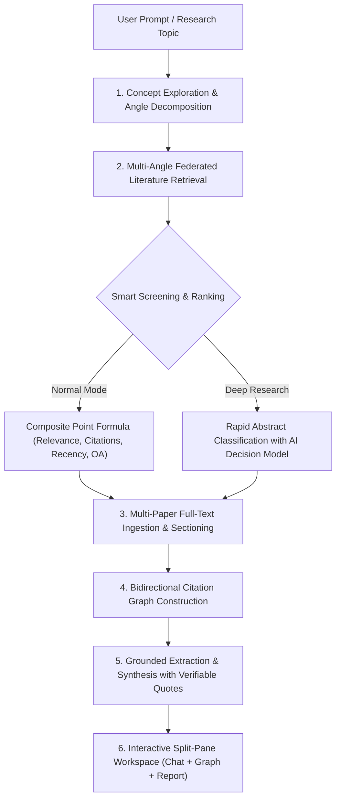

# Kuorum

> **Autonomous Academic Research Companion**: Multi-angle concept discovery, federated literature retrieval, citation graph traversal, and zero-hallucination grounded synthesis.

---

## About The Project

Modern AI chatbots often struggle with academic research: they hallucinate citations, summarize papers superficially without reading full texts, and fail to provide verifiable provenance for their claims.

**Kuorum** is an autonomous academic literature assistant designed to bridge the gap between conversational AI and rigorous scientific research. Given a high-level research topic or exploratory question, the platform automatically deconstructs the topic into distinct scholarly dimensions, retrieves candidate papers from world-class academic repositories (OpenAlex, Semantic Scholar, arXiv, and Crossref), reads their full text, maps their citation networks, and synthesizes structured insights with **verifiable, quote-level provenance**.

Whether you are drafting a literature review, identifying theoretical roots of a technique, or scouting real-world applications of a method, Kuorum accelerates the journey from a vague idea to grounded scientific understanding.

---

## How It Works

Kuorum operates as an autonomous, multi-stage research pipeline that guides your exploration from query to synthesis:



1. **Concept Exploration & Deconstruction**: The engine deconstructs raw prompts into distinct research angles, technical keywords, and domain terminology.
2. **Federated Literature Retrieval**: Queries multiple academic repositories simultaneously, pulling candidate papers and eliminating duplicates across sources.
3. **Smart Screening & Ranking**: Automatically scores and selects top candidate papers using either transparent multi-metric point calculations (Normal Mode) or high-volume rapid abstract classification (Deep Research Mode).
4. **Autonomous Full-Text Ingestion**: Downloads open-access PDFs, reflows multi-column academic layouts, and segments content into semantic sections (*Introduction*, *Methodology*, *Results*, *Discussion*, *References*).
5. **Bidirectional Citation Graph Traversal**: Discovers backward references (foundational baseline theories) and forward citations (practical real-world applications) to map the evolution of the field.
6. **Grounded Synthesis & Verification**: Produces structured definitions, technical mechanisms, and empirical case studies where every assertion links directly to original paper excerpts.
7. **Interactive Workspace Delivery**: Presents findings in an interactive split-view interface featuring real-time thinking progress, interactive citation networks, and deep-dive reports.

---

## Features

### Multi-Angle Concept Decomposition
Instead of relying on a single simplistic search query, the engine analyzes your prompt from multiple academic dimensions (e.g., theoretical foundations, algorithmic design, empirical validation, or domain-specific applications). You can select an angle interactively or let the autonomous pipeline explore all facets.

### Dual Research Approaches (Normal vs. Deep Research)
- **Normal Research Mode**: Fast, focused exploration. Retrieves candidate papers and applies a balanced composite scoring formula ($45\%$ relevance, $25\%$ citation authority, $15\%$ recency, and $15\%$ open-access availability) to automatically select top papers for deep reading.
- **Deep Research Mode**: Comprehensive, high-volume harvest. Queries federated repositories for up to hundreds of papers and runs rapid abstract classification using an AI decision model (powered by Cloudflare Clef) to uncover niche papers, emerging preprints, and interdisciplinary breakthroughs.

### Autonomous Multi-Paper Deep Dive
Say goodbye to manually opening dozens of browser tabs. Kuorum downloads open-access PDFs, extracts section text (Methodologies, Experiments, Results), and performs multi-paper comparative analysis automatically.

### Interactive 2D Citation Graph Visualizer
Explore the academic lineage of your topic in an interactive visual network:
- **Anchor Papers** highlighted in gold.
- **Foundational References** (the seminal theories your topic builds upon) in teal.
- **Practical Applications** (downstream works utilizing the concept) in purple/blue.
- Drag, reposition, zoom, and click nodes to view incoming and outgoing citation breakdowns.

### Grounded Synthesis with Verifiable Provenance
Every generated synthesis is strictly grounded in the literature:
- **Formal Definitions**: Precise conceptual and mathematical explanations.
- **Step-by-Step Mechanisms**: Concrete algorithmic or procedural breakdowns.
- **Empirical Case Studies**: Real-world metrics, datasets, and outcomes achieved.
- **Citation Pills & Source Drawer**: Interactive pills link claims directly to verbatim passages from source papers.

### Modern Split-Pane Workspace
- **Left Pane**: Dynamic conversational interface with step-by-step thinking processes, execution checkpoints, and follow-up prompts.
- **Right Pane**: Collapsible detail panel featuring tabs for the **Synthesis Report**, the **Citation Graph**, and the **Paper References Index**.
- **Resizable Splitter**: Customize your screen real estate seamlessly.

### Multi-Model AI Agility
Effortlessly switch between leading AI models directly from the UI header menu, including:
- **Google Gemini** (Gemini 2.5 Flash, Gemini 1.5 Pro)
- **Anthropic Claude** (Claude 3.5 Sonnet, Claude 3 Haiku)
- **OpenAI** (GPT-4o, GPT-4o-mini)
- **DeepSeek & Groq** (DeepSeek V3/R1, Llama 3 models)

### Academic Literature Search & Inspector
A built-in search dialog allows manual exploration of OpenAlex, Semantic Scholar, arXiv, and Crossref, complete with author rosters, publication years, venue tags, DOIs, and direct PDF links.

---

## Setup & Installation

### Prerequisites

Ensure you have the following installed on your system:

| Requirement | Recommended Version | Purpose |
| :--- | :--- | :--- |
| **Go** | `1.22+` (or `1.24+`) | Backend API & CQRS Orchestrator |
| **Node.js** | `18.x` or `20.x+` | Frontend Web UI |
| **pnpm** (or npm) | `9.x+` | Package manager |
| **Poppler Utilities** | Latest | PDF layout extraction (`pdftotext`, `pdfinfo`) |

#### Installing Poppler Utilities

Poppler is used for high-fidelity extraction of multi-column academic PDFs:
- **Ubuntu / Debian**:
  ```bash
  sudo apt update && sudo apt install -y poppler-utils
  ```
- **macOS** (via Homebrew):
  ```bash
  brew install poppler
  ```
- **Windows** (via Chocolatey or Scoop):
  ```bash
  choco install poppler
  # or
  scoop install poppler
  ```

---

### Step 1: Clone the Repository

```bash
git clone https://github.com/your-username/research-helper.git
cd research-helper
```

### Step 2: Configure Environment Variables

The backend requires an environment file for LLM keys and academic polite pool configuration:

```bash
cd backend
cp .env.example .env
```

Open `.env` in your text editor and add your preferred provider credentials:

```ini
# LLM Providers (Provide at least one)
OPENAI_API_KEY=sk-...
GEMINI_API_KEY=AIza...
ANTHROPIC_API_KEY=sk-ant-...
GROQ_API_KEY=gsk_...
DEEPSEEK_API_KEY=sk-...

# Cloudflare Workers AI (Optional: used for rapid screening in Deep Research mode)
CLOUDFLARE_ACCOUNT_ID=
CLOUDFLARE_API_TOKEN=
CLOUDFLARE_CLEF_MODEL=@cf/cloudflare/clef-flash

# Database Persistence (Uses pure Go SQLite; zero configuration needed)
DB_PATH=kuorum.db

# Polite Academic Access (Helps identify requests to OpenAlex/CrossRef)
POLITE_EMAIL=your-email@example.com
```

> [!NOTE]
> Database persistence uses **pure Go SQLite** (`modernc.org/sqlite`), meaning **no CGO or C compiler (gcc/clang)** is required! The database file (`kuorum.db`) and its schema migrations are initialized automatically on first startup.

### Step 3: Install Dependencies

1. **Backend**:
   ```bash
   cd backend
   go mod download
   ```

2. **Frontend**:
   ```bash
   cd ../frontend
   pnpm install
   # or: npm install
   ```

---

## Running the Application

### Option A: Development Mode (Recommended for Hacking)

Run the backend and frontend in separate terminals with hot reloading:

#### 1. Start the Backend API
```bash
cd backend
go run -buildvcs=false cmd/api/main.go
```
The Go backend starts on `http://localhost:8080`.

#### 2. Start the Frontend Dev Server
```bash
cd frontend
pnpm dev
# or: npm run dev
```
The frontend starts on `http://localhost:5173`. Vite automatically proxies API requests (`/api/*`) to the backend on port `8080`.

Open your browser at `http://localhost:5173`.

---

### Option B: Unified Production Build (Single Port Serving)

You can build the frontend into static assets and let the Go backend serve both the REST API and the single-page application from port `8080`:

```bash
# 1. Build frontend
cd frontend
pnpm build

# 2. Run backend
cd ../backend
go run -buildvcs=false cmd/api/main.go
```
Open `http://localhost:8080` in your browser.

---

## Development & Engineering

### Helpful Developer Commands

#### Backend
- **Run all unit & CQRS tests**:
  ```bash
  cd backend
  go test ./...
  ```
- **Run tests with verbose logging**:
  ```bash
  go test -v ./internal/application/retrieval/...
  ```
- **Recompile SQL queries (optional, requires sqlc)**:
  ```bash
  sqlc generate
  ```

#### Frontend
- **Type-check and lint**:
  ```bash
  cd frontend
  pnpm check
  pnpm lint
  ```
- **Format code**:
  ```bash
  pnpm format
  ```
- **Production bundle build**:
  ```bash
  pnpm build
  ```

---

## License

This project is open-source and available under the [MIT License](LICENSE).
